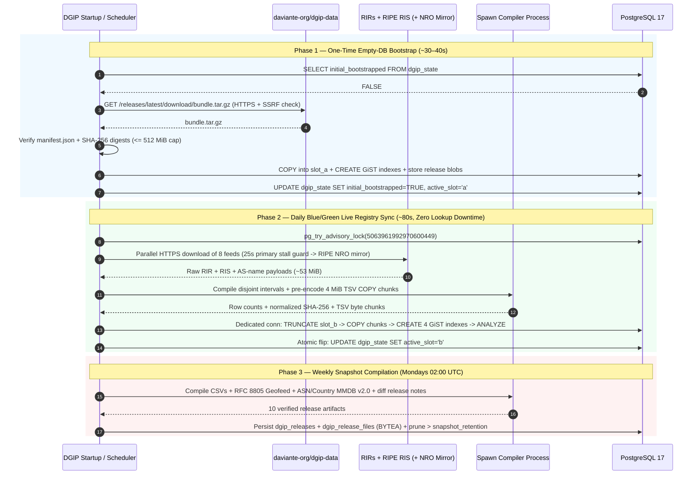

# DGIP System Architecture & Internal Design

**Maintainer:** Daviante (`https://daviante.org`)  
**Repository:** `https://github.com/daviante-org/dgip`  
**Companion Dataset Repository:** `https://github.com/daviante-org/dgip-data`

`dgip` is a self-hosted 4-layer IPv4 and IPv6 network intelligence engine that ingests 25 authoritative Regional Internet Registry (RIR) delegation files, RIPE NCC Routing Information Service (RIS) BGP dumps, OpenBSD `rpki-client` Validated ROA Payloads (VRPs), `bgp.tools` AS classifications, RFC 8805 operator/cloud regional geofeeds, and open security/threat feeds; compiles disjoint routing, sub-national geolocation, and multi-label security intervals; serves sub-10ms REST lookups from PostgreSQL GiST range indexes; and packages weekly multi-format dataset snapshots.

---

## 1. High-Level Topology

```mermaid
flowchart TB
    subgraph External["Authoritative Public Infrastructure"]
        RIR["5 Regional Internet Registries\nARIN · RIPE NCC · APNIC · LACNIC · AFRINIC\n(NRO Extended Delegation Files)"]
        NRO_MIRROR["RIPE NCC Official NRO Mirrors\nftp.ripe.net/pub/stats/*\n(Automatic >25s Stall Fallback)"]
        RIS["RIPE NCC RIS & AS Names\nriswhoisdump IPv4/IPv6 + asn.txt"]
        DGIP_DATA["GitHub: daviante-org/dgip-data\nWeekly Public Releases (vYYYY.Www)\nCSV · Geofeed · MMDB · OIDC SLSA"]
    end

    subgraph Runtime["DGIP Scratch Container / Pod (UID 10001:0 or OpenShift restricted-v2, Read-Only RootFS)"]
        ASGI["Axum Security & Streaming Body Guard\nStreaming Body Cap (256 KiB) + CSP Headers"]
        API["Axum Read-Only HTTP Server (:8090)\n/healthz/* · /v1/ip/* · /v1/snapshots/* · /docs"]
        SCHED["Background Tokio Scheduler\nDaily Live Sync + Monday 02:00 UTC Release"]
        CLI["Static CLI Binary (/usr/local/bin/dgip)\ndgip status · sync · release · config · feed · host"]
        WORKER["Blocking Compiler Pool (spawn_blocking)\nInterval Flattener + MMDB v2.0 + TSV Chunk Encoder"]
        CACHE["Local Artifact Cache (/tmp/dgip-cache or volume)\nSingleflight Snapshot Hydrator"]
    end

    subgraph PG["PostgreSQL 17 State & GiST Engine"]
        SLOT_A["Blue Slot (*_a)\n6 GiST Range Tables (ASN, Country, Security)"]
        SLOT_B["Green Slot (*_b)\n6 GiST Range Tables (ASN, Country, Security)"]
        CATALOG["Catalog Tables + Triggers\ndgip_config · feeds · hosts · countries · special_ranges"]
        BLOBS["Snapshot Store\ndgip_releases + dgip_release_files (BYTEA)"]
        STATE["dgip_state (id=1)\nactive_slot · catalog_version · sync timestamps"]
    end

    Clients["HTTP Clients & Services"] --> ASGI --> API
    API -- "1 GiST Query (Active Slot)" --> SLOT_A
    API -. "Atomic Slot Flip" .-> SLOT_B
    API <--> CACHE <--> BLOBS
    Operators["Platform Operators\n(docker/podman/kubectl/oc exec)"] --> CLI
    CLI --> WORKER
    CLI --> CATALOG
    SCHED --> WORKER
    DGIP_DATA -- "1. One-Time Empty-DB Bootstrap" --> SCHED
    RIR -- "2. Primary HTTPS Fetch" --> SCHED
    NRO_MIRROR -. "Fallback on Origin Throttle" .-> SCHED
    RIS -- "2. BGP & ASN HTTPS Fetch" --> SCHED
    WORKER -- "Dedicated AsyncConnection COPY\n+ Build GiST Indexes + ANALYZE" --> SLOT_B
    WORKER -- "Store Weekly Snapshot" --> BLOBS
    DGIP_DATA <-- "3. Monday 02:30 UTC Pull\n(/v1/snapshots/latest)" --- API
```

---

## 2. Core Architectural Principles

1. **100% Read-Only Network Surface**:
   The HTTP listener (`src/http.rs`) exposes zero administrative, mutating, or configuration endpoints. All operational controls (`dgip sync`, `dgip release`, `dgip config`, `dgip feed`, `dgip host`) execute exclusively via the local `/usr/local/bin/dgip` static Rust CLI gated by container/Kubernetes/OpenShift runtime RBAC.
2. **Zero Third-Party Aggregator Dependencies**:
   After a single optional fast-start bootstrap from `daviante-org/dgip-data`, `dgip` compiles directly from primary RIR and RIPE NCC feeds. No commercial geolocation APIs or third-party GitHub scrapers are queried.
3. **Zero-Downtime Blue/Green GiST Indexing**:
   Live IPv4 (`int8range`) and IPv6 (`numrange`) tables exist in twin table sets (`*_a` and `*_b`). Background refreshes write exclusively to the inactive slot over a dedicated `tokio-postgres` connection outside the HTTP request pool, build fresh GiST indexes, run `ANALYZE`, and flip `dgip_state.active_slot` in a single atomic transaction.
4. **Native Zero-GC Rust Compilation**:
   CPU-intensive parsing of ~1,036,000 intervals, binary radix-tree construction for `.mmdb` files, and streaming TSV `COPY` chunk encoding execute on Tokio's blocking threadpool (`tokio::task::spawn_blocking`) using compact primitive `u32`/`u128` structs (`< 15 MiB` idle RAM, deterministic release of compilation buffers, and sub-millisecond Tokio HTTP scheduling).
5. **Stateless Multi-Replica Horizontal Scaling**:
   All persistent state — including weekly snapshot binaries (`dgip_release_files` `BYTEA`) and runtime configuration (`dgip_config`) — lives in PostgreSQL. Any number of API replicas can scale horizontally behind a load balancer:
   - Replicas coordinate background sync and release jobs via non-blocking PostgreSQL advisory locks (`pg_try_advisory_lock(5063961992970600449)`).
   - Replicas hydrate requested snapshot files into ephemeral `/tmp/dgip-cache` on demand using per-artifact singleflight locks (`_artifact_locks`) so cold caches never trigger concurrent `BYTEA` stampedes.

---

## 3. Three-Phase Data Lifecycle



---

## 4. PostgreSQL Schema Overview

All tables are created idempotently on startup (`SCHEMA_SQL` in `src/db.rs`):

| Table | Purpose |
| :--- | :--- |
| `dgip_state` | Single-row (`id = 1`) coordination record tracking `catalog_seeded`, `catalog_version`, `initial_bootstrapped`, `active_slot` (`a` or `b`), `active_version`, `live_feed_sha256`, `live_row_counts`, and sync/release timestamps & error messages. |
| `dgip_config` | Key-value `JSONB` runtime parameters (`rate_limit_per_minute`, `trusted_proxies`, `bgp_min_peers`, `swagger_enabled`, etc.). |
| `dgip_feed_sources` | Upstream registry feed URLs, types (`rir_delegated`, `ris_bgp`, `asn_names`), `min_records` sanity thresholds, and byte caps. |
| `dgip_allowed_hosts` | Outbound HTTPS FQDN allowlist enforced on every request and redirect hop. |
| `dgip_continents` | 7 ISO continent codes (`AF`, `AN`, `AS`, `EU`, `NA`, `OC`, `SA`). |
| `dgip_countries` | 253 ISO 3166-1 alpha-2 country and territory definitions mapped to continents. |
| `dgip_special_ranges` | 29 IANA RFC 6890 / RFC 4291 special-purpose bogon CIDRs with priority precedence. |
| `dgip_releases` | Immutable metadata, `manifest_json`, `row_counts`, `diff_summary_json`, and `release_notes_md` for every cut snapshot (`has_blobs` tracks retention). |
| `dgip_release_files` | Binary `BYTEA` payloads and SHA-256 digests for retained snapshot artifacts (`ON DELETE CASCADE`). |
| `dgip_asn_v4_{a,b}` | Blue/Green IPv4 BGP ASN intervals (`asn`, `asn_org`, `network_type`, `rpki_status`) indexed with GiST over `int8range`. |
| `dgip_asn_v6_{a,b}` | Blue/Green IPv6 BGP ASN intervals (`asn`, `asn_org`, `network_type`, `rpki_status`) indexed with GiST over `numrange`. |
| `dgip_country_v4_{a,b}` | Blue/Green IPv4 geolocation intervals (`country_code`, `region_code`, `city`, `geo_source`) indexed with GiST over `int8range`. |
| `dgip_country_v6_{a,b}` | Blue/Green IPv6 geolocation intervals (`country_code`, `region_code`, `city`, `geo_source`) indexed with GiST over `numrange`. |
| `dgip_security_v4_{a,b}` | Blue/Green IPv4 multi-label security/infrastructure intervals (`flags`, `provider`, `threat_feeds`) indexed with GiST over `int8range`. |
| `dgip_security_v6_{a,b}` | Blue/Green IPv6 multi-label security/infrastructure intervals (`flags`, `provider`, `threat_feeds`) indexed with GiST over `numrange`. |

### Trigger-Driven Catalog Hot-Reload
Statement-level triggers (`trg_dgip_*_ver`) on `dgip_config`, `dgip_feed_sources`, `dgip_allowed_hosts`, `dgip_continents`, `dgip_countries`, and `dgip_special_ranges` execute `dgip_bump_catalog_version()`, incrementing `dgip_state.catalog_version`. Every active HTTP worker polls `catalog_version` at most once per `DGIP_CATALOG_POLL_SECONDS` (`2.0s` default) and atomically swaps its in-memory `RuntimeCatalog` and sliding-window rate-limiter parameters when a bump is detected.

---

## 5. Codebase Module Map

| File | Responsibility |
| :--- | :--- |
| `src/http.rs` | Axum streaming body-limit & security-header middleware, read-only HTTP routes, and graceful shutdown server. |
| `src/cli.rs` | Unified `dgip` binary entrypoint (`serve`, `healthcheck`, `status`, `sync`, `release`, `catalog`, `config`, `feed`, `host`, `build-release`). |
| `src/db.rs` | `deadpool-postgres` pool (`rustls` + `NoTls`), schema initialization, trigger-polled `RuntimeCatalog`, GiST single/batch queries, and singleflight `BYTEA` cache hydration. |
| `src/sync.rs` | SSRF-hardened `reqwest` downloader (pinned resolved socket addresses), RIPE NCC NRO mirror stall fallback, streaming `COPY` loader, and advisory-locked sync/release workflows. |
| `src/compiler.rs` | Layer 1–4 unified feed compiler (`compile_feed_payloads`), binary CIDR flattener (`flatten_binary_cidrs_v4`/`v6`), RFC 4180 CSV & RFC 8805 Geofeed writers, and `bundle.tar.gz` packager/unpacker. |
| `src/enrichment.rs` | Layer 2 RFC 8805/GCP/OCI regional geofeed parsers & `O(N+M)` overlay, Layer 3 RFC 6811/7607 RPKI VRP validator & AS network classifier, and Layer 4 multi-label security sweep-line (`merge_security_intervals_v4`/`v6`). |
| `src/mmdb.rs` | Native Rust MaxMind DB Binary Format v2.0 (`24-bit`, `28-bit`, and `32-bit` record size) dual-stack tree builder (`dgip-asn.mmdb`, `dgip-country.mmdb`, `dgip-security.mmdb`). |
| `src/ip_utils.rs` | Strict IPv4/IPv6 literal parser, RFC 4291 IPv4-mapped IPv6 normalizer, RFC 6890 bogon classifier, and right-to-left `X-Forwarded-For` extractor. |
| `src/ratelimit.rs` | Bounded-memory O(1) LRU per-IP sliding-window rate limiter emitting `X-RateLimit-*` and `Retry-After` headers. |
| `src/release_notes.rs` | ISO-8601 week version formatter (`vYYYY.Www`) and automated dataset diff & Markdown release notes generator. |
| `src/swagger.rs` | Zero-CDN interactive portal (`GET /`), OpenAPI 3.1 contract loader (`openapi.yaml`), and Daviante-branded Swagger UI v5 HTML renderer (`GET /docs`). |
| `src/seed_data.rs` | Default ISO countries, continents, RFC 6890 special ranges, 26 SSRF-allowed hosts, 25 Layer 1–4 feeds, and 30 default `dgip_config` values. |
